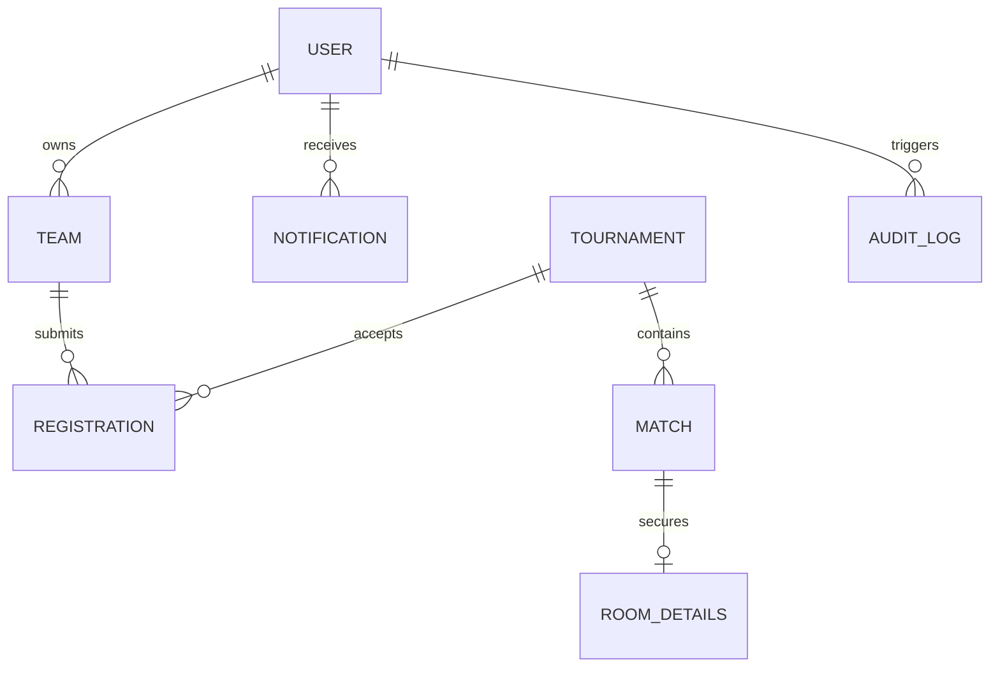

# Esport Hub — Database Design & Schema Specifications

## 1. Overview
The database engine is built on **MongoDB** using **Mongoose ODM**. It provides a schema-enforced relational document architecture with indexes, compound unique constraints, and population helpers.

---

## 2. Collection Schemas & Entity Relationships



### 2.1 User (`users`)
```javascript
{
  _id: ObjectId,
  name: { type: String, required: true, trim: true },
  email: { type: String, required: true, unique: true, lowercase: true, index: true },
  passwordHash: { type: String, required: true },
  role: { type: String, enum: ['player', 'organizer', 'admin'], default: 'player', index: true },
  avatar: { type: String, default: '' },
  gameProfiles: {
    bgmiId: { type: String, default: '' },
    bgmiIgn: { type: String, default: '' },
    freefireUid: { type: String, default: '' },
    freefireIgn: { type: String, default: '' }
  },
  accountStatus: { type: String, enum: ['active', 'suspended'], default: 'active' },
  createdAt: Date,
  updatedAt: Date
}
```

### 2.2 Team (`teams`)
```javascript
{
  _id: ObjectId,
  name: { type: String, required: true, trim: true },
  tag: { type: String, required: true, trim: true, uppercase: true },
  game: { type: String, enum: ['BGMI', 'Free Fire'], required: true },
  logo: { type: String, default: '' },
  owner: { type: ObjectId, ref: 'User', required: true, index: true },
  members: [{
    user: { type: ObjectId, ref: 'User', required: true },
    role: { type: String, enum: ['leader', 'member'], default: 'member' },
    joinedAt: { type: Date, default: Date.now }
  }],
  inviteCode: { type: String, required: true, unique: true },
  createdAt: Date,
  updatedAt: Date
}
```

### 2.3 Tournament (`tournaments`)
```javascript
{
  _id: ObjectId,
  name: { type: String, required: true, trim: true },
  slug: { type: String, required: true, unique: true, index: true },
  game: { type: String, enum: ['BGMI', 'Free Fire'], required: true, index: true },
  description: { type: String, required: true },
  banner: { type: String, default: '' },
  organizer: { type: ObjectId, ref: 'User', required: true, index: true },
  format: { type: String, enum: ['single_elimination'], default: 'single_elimination' },
  teamSize: { type: String, enum: ['solo', 'duo', 'squad'], default: 'squad' },
  maxTeams: { type: Number, required: true, min: 2, max: 64 },
  entryFee: { type: Number, default: 0 },
  currency: { type: String, default: 'INR' },
  prizePool: { type: Number, default: 0 },
  prizeDistribution: [{
    place: { type: String, required: true }, // e.g. "1st", "2nd"
    amount: { type: Number, required: true }
  }],
  rules: { type: String, default: '' },
  registrationStart: { type: Date, required: true },
  registrationDeadline: { type: Date, required: true },
  startDate: { type: Date, required: true },
  status: {
    type: String,
    enum: ['draft', 'published', 'registration_open', 'registration_closed', 'ongoing', 'completed', 'cancelled'],
    default: 'draft',
    index: true
  },
  createdAt: Date,
  updatedAt: Date
}
```

### 2.4 Registration (`registrations`)
```javascript
{
  _id: ObjectId,
  tournament: { type: ObjectId, ref: 'Tournament', required: true, index: true },
  team: { type: ObjectId, ref: 'Team', required: true, index: true },
  submittedBy: { type: ObjectId, ref: 'User', required: true },
  roster: [{
    user: { type: ObjectId, ref: 'User', required: true },
    inGameId: { type: String },
    inGameName: { type: String }
  }],
  status: {
    type: String,
    enum: ['pending', 'approved', 'rejected'],
    default: 'pending',
    index: true
  },
  reviewedBy: { type: ObjectId, ref: 'User' },
  reviewedAt: Date,
  rejectionReason: { type: String, default: '' },
  createdAt: Date,
  updatedAt: Date
}
// Compound unique index: Ensure a team registers only once per tournament
// registrations.index({ tournament: 1, team: 1 }, { unique: true });
```

### 2.5 Match (`matches`)
```javascript
{
  _id: ObjectId,
  tournament: { type: ObjectId, ref: 'Tournament', required: true, index: true },
  round: { type: Number, required: true }, // 1 = Quarterfinals / Round of 16, etc.
  matchNumber: { type: Number, required: true }, // Positional in round
  team1: { type: ObjectId, ref: 'Team', default: null },
  team2: { type: ObjectId, ref: 'Team', default: null },
  scheduledAt: { type: Date },
  status: {
    type: String,
    enum: ['pending', 'scheduled', 'live', 'completed', 'cancelled'],
    default: 'pending'
  },
  scores: {
    team1Score: { type: Number, default: 0 },
    team2Score: { type: Number, default: 0 }
  },
  winner: { type: ObjectId, ref: 'Team', default: null },
  nextMatch: { type: ObjectId, ref: 'Match', default: null },
  nextMatchSlot: { type: Number, enum: [1, 2] },
  resultPublishedAt: Date,
  createdAt: Date,
  updatedAt: Date
}
```

### 2.6 RoomDetails (`room_details`)
```javascript
{
  _id: ObjectId,
  match: { type: ObjectId, ref: 'Match', required: true, unique: true, index: true },
  tournament: { type: ObjectId, ref: 'Tournament', required: true },
  roomId: { type: String, required: true },
  encryptedPassword: { type: String, required: true }, // AES-256 encrypted string
  iv: { type: String, required: true }, // Initialization vector
  releaseAt: { type: Date, required: true },
  instructions: { type: String, default: '' },
  accessStatus: { type: String, enum: ['scheduled', 'published', 'revoked'], default: 'scheduled' },
  createdBy: { type: ObjectId, ref: 'User', required: true },
  updatedAt: Date
}
```

### 2.7 Notification (`notifications`)
```javascript
{
  _id: ObjectId,
  recipient: { type: ObjectId, ref: 'User', required: true, index: true },
  type: {
    type: String,
    enum: ['reg_approved', 'reg_rejected', 'match_scheduled', 'room_released', 'tournament_started', 'general'],
    required: true
  },
  title: { type: String, required: true },
  message: { type: String, required: true },
  link: { type: String, default: '' },
  read: { type: Boolean, default: false, index: true },
  createdAt: { type: Date, default: Date.now }
}
```

### 2.8 AuditLog (`audit_logs`)
```javascript
{
  _id: ObjectId,
  action: { type: String, required: true },
  actor: { type: ObjectId, ref: 'User', required: true },
  targetType: { type: String, required: true }, // 'User', 'Tournament', 'Match', 'Room'
  targetId: { type: ObjectId, required: true },
  details: { type: Object, default: {} },
  ipAddress: String,
  createdAt: { type: Date, default: Date.now }
}
```

### 2.9 Dispute (`disputes`)
```javascript
{
  _id: ObjectId,
  reportedBy: { type: ObjectId, ref: 'User', required: true },
  match: { type: ObjectId, ref: 'Match' },
  tournament: { type: ObjectId, ref: 'Tournament' },
  team: { type: ObjectId, ref: 'Team' },
  issueType: { type: String, enum: ['room_credentials', 'no_show', 'cheating_impersonation', 'score_dispute', 'other'], default: 'other' },
  description: { type: String, required: true, trim: true, maxlength: 1500 },
  evidenceUrl: String,
  status: { type: String, enum: ['pending', 'investigating', 'resolved', 'dismissed'], default: 'pending', index: true },
  resolutionNotes: String,
  resolvedBy: { type: ObjectId, ref: 'User' },
  resolvedAt: Date,
  createdAt: Date,
  updatedAt: Date
}
```

### 2.10 Payment (`payments`)
```javascript
{
  _id: ObjectId,
  user: { type: ObjectId, ref: 'User', required: true },
  tournament: { type: ObjectId, ref: 'Tournament', required: true },
  team: { type: ObjectId, ref: 'Team', required: true },
  amount: { type: Number, required: true, min: 0 },
  currency: { type: String, default: 'INR' },
  orderId: { type: String, required: true, unique: true },
  paymentId: String,
  signature: String,
  status: { type: String, enum: ['created', 'attempted', 'captured', 'failed', 'refunded'], default: 'created' },
  method: { type: String, default: 'upi' },
  verifiedAt: Date,
  createdAt: Date,
  updatedAt: Date
}
```
