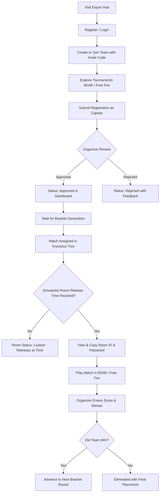
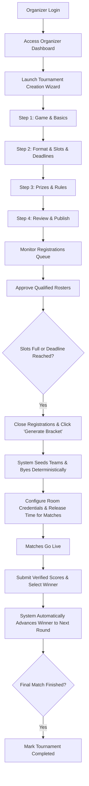
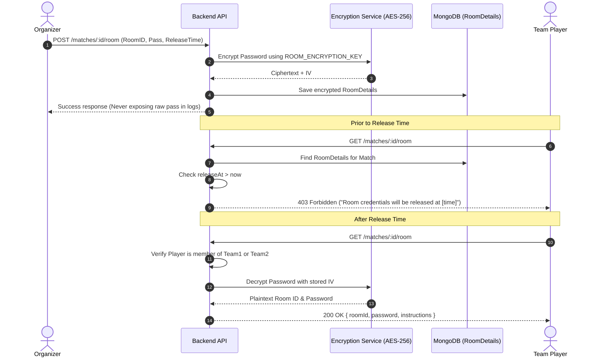

# Esport Hub — User Flows & Operational Lifecycles

## 1. Player Journey

---

## 2. Tournament Organizer Journey

---

## 3. Room ID & Password Security Flow

---

## 4. Single-Elimination Bracket Logic with Byes
- For $N$ teams, the bracket size is the next power of 2, denoted as $P = 2^{\lceil \log_2 N \rceil}$.
- The number of byes is $B = P - N$.
- Number of matches in Round 1 is $(N - B) / 2 = N - P/2$.
- Teams receiving byes skip Round 1 and advance automatically to Round 2.
- Deterministic seeding ensures balanced brackets without unpredictable changes on reloads.
